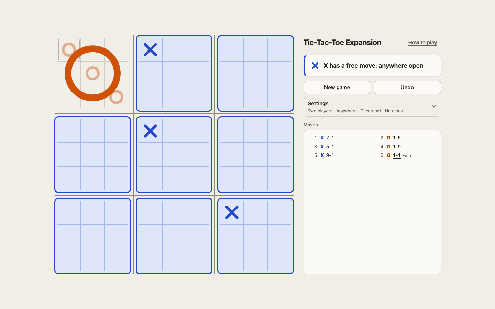

# Tic-Tac-Toe Expansion

A big tic-tac-toe board where every square holds a small tic-tac-toe board.
The small square you play in decides which big square your opponent must play
in next.

Play it: https://charlesyapai.github.io/tictactoe_expansion/



## Rules in short

- Squares are numbered 1 to 9, row by row, at both levels. A move is written
  `4-1`: big square 4, small square 1.
- Play in small square 1 and your opponent must play in big square 1. The
  board highlights where the next move can go.
- Three in a row on a small board wins that big square.
- Sent to a big square that is closed? You get a free move. Depending on the
  setting it can go anywhere open, or only in the big squares touching it.
- A small board that fills up with no winner is a tie. Depending on the
  setting it is wiped and stays in play, or it stays closed and belongs to
  nobody.
- Win three big squares in a row to win the game.

The full rules, with diagrams, are in [docs/SPEC.md](docs/SPEC.md).

## Features

- Two players on one device, or play the computer at three levels
- Both free-move modes, switchable during a game
- Two tie settings: reset the square, or leave it closed
- Optional chess-style clock: 1, 3, 5 or 10 minutes each, with an increment
  if you want one. It passes to the other player when you move, and running
  out of time loses.
- Undo, move list, optional square numbers
- Works on phones, in portrait and landscape
- Light and dark themes, keyboard play
- The game in progress is saved in the browser

## Run it locally

There is nothing to install or build. Browsers do not load JavaScript modules
from `file://`, so serve the folder:

```
python3 -m http.server 8000
```

Then open http://localhost:8000.

## Tests

```
node --test tests/
```

The tests use Node's built-in runner (tested on Node 26). They cover the rules and the computer opponent.

## Link parameters

| Parameter | Values | Effect |
|---|---|---|
| `moves` | `4-1,1-5,5-5` | Replays these moves on load. Nothing is saved while it is present. |
| `mode` | `anywhere`, `adjacent` | Free-move rule |
| `tie` | `reset`, `stay` | What a tied square does |
| `clock` | `1`, `3`, `5`, `10` | Minutes per player |
| `inc` | `0`, `2`, `5`, `10` | Seconds added after each move |
| `opponent` | `two`, `computer` | Who you play |
| `level` | `easy`, `medium`, `hard` | Computer level |
| `side` | `X`, `O` | Your side against the computer |
| `numbers` | `1` | Show square numbers |
| `theme` | `light`, `dark` | Force a theme |

## Files

```
index.html       page
css/styles.css   layout and themes
js/engine.js     rules (no DOM)
js/ai.js         computer opponent
js/ui.js         rendering and input
tests/           rules and computer opponent tests
docs/            spec, diagrams, screenshots
```
