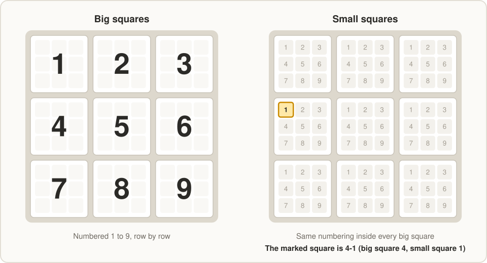
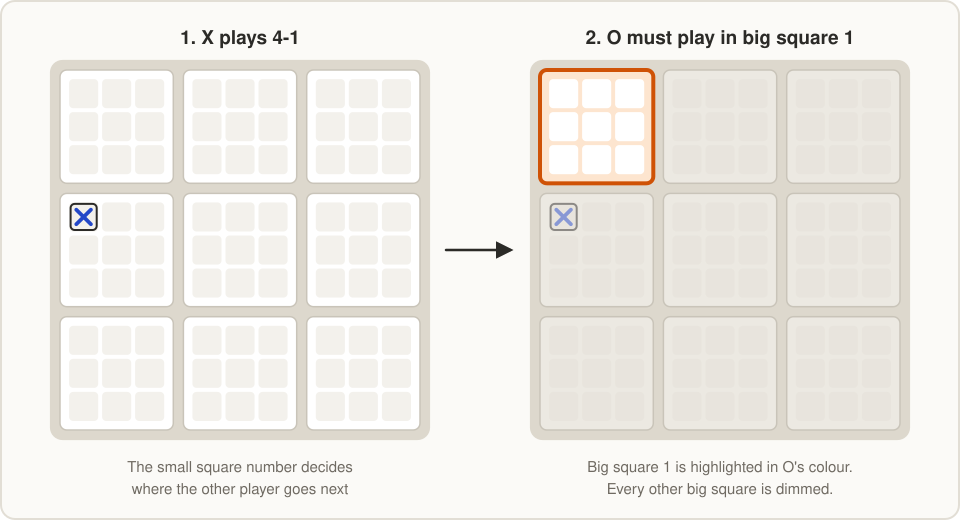
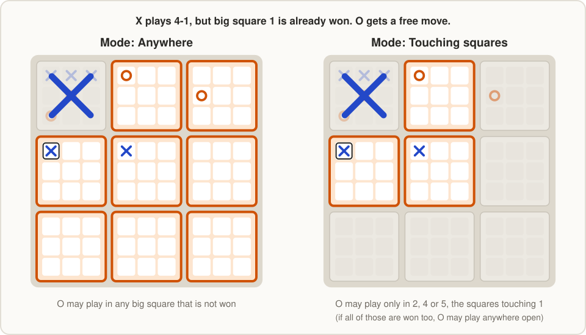
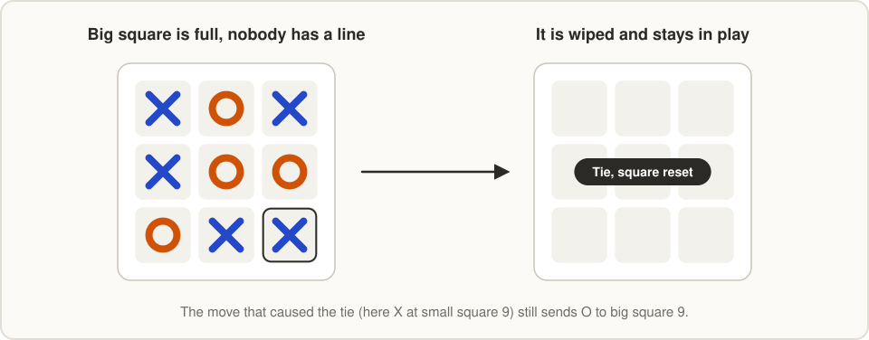
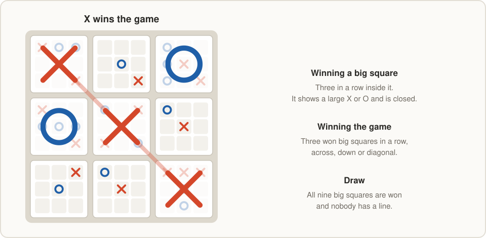
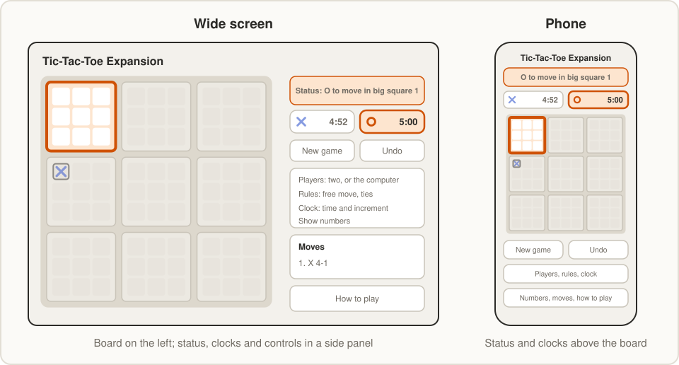
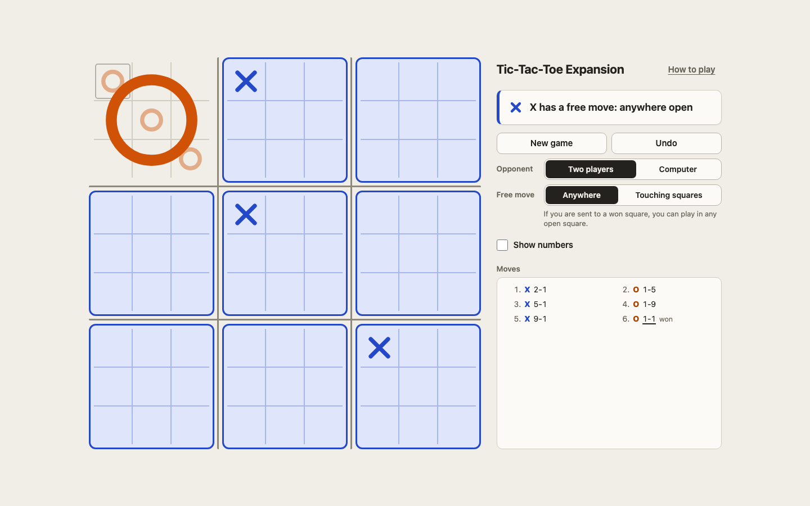
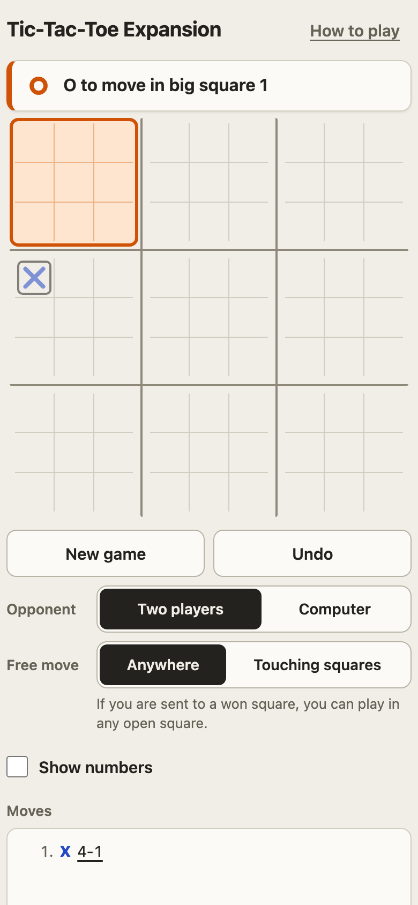
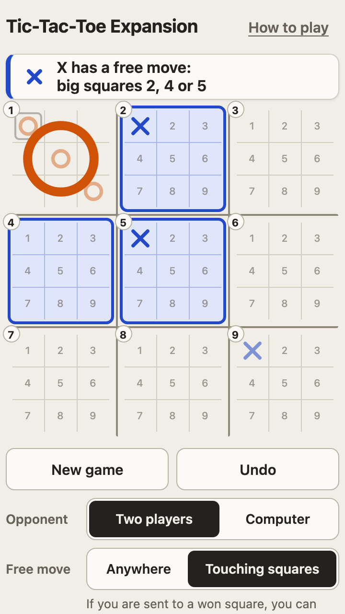

# Tic-Tac-Toe Expansion: plan and spec

A two-level tic-tac-toe for the browser. The big board has nine squares, and
each of them holds a small tic-tac-toe board. Where you play in a small board
decides which big square your opponent has to play in next.

It is a static site with no build step, hosted on GitHub Pages from this repo.

Status of this document: the game is built to this spec. The diagrams in
sections 1 to 3 were drawn before the build and show the rules. Section 4 has
screenshots of the finished game. Keep this file in step with the game when
either changes.

## Contents

1. [Numbering and notation](#1-numbering-and-notation)
2. [Rules](#2-rules)
3. [Where the next move can go](#3-where-the-next-move-can-go)
4. [Screen](#4-screen)
5. [Computer opponent](#5-computer-opponent)
6. [Phone support](#6-phone-support)
7. [Code layout](#7-code-layout)
8. [Build plan](#8-build-plan)
9. [Checks before release](#9-checks-before-release)
10. [Publishing](#10-publishing)
11. [Decisions and open questions](#11-decisions-and-open-questions)

## 1. Numbering and notation

Big squares are numbered 1 to 9, row by row. The small squares inside each big
square use the same numbering.



A move is written `B-C`: big square B, small square C. `4-1` is the top-left
small square of the middle-left big square. The move list on screen uses this
notation, for example `1. X 4-1`.

## 2. Rules

X moves first, and the first move can go anywhere. Players then alternate.

### Sending rule

The small square you play in sends your opponent to the big square with the
same number. After `4-1`, the opponent must play somewhere inside big square 1.



### Winning a big square

Three in a row inside a small board wins that big square. It shows a large X
or O and is closed for the rest of the game.

### Free moves

If you are sent to a big square that is already won, you get a free move.
There are two modes, chosen with a switch on screen.

| Mode | Where the free move can go |
|---|---|
| Anywhere (default) | Any big square that is not won |
| Touching squares | Only open big squares touching the one you were sent to, diagonals included. Sent to 1 means 2, 4 or 5. If all of those are won as well, anywhere open. |



Squares that touch each big square, for the second mode:

| Sent to | Touching squares |
|---|---|
| 1 | 2, 4, 5 |
| 2 | 1, 3, 4, 5, 6 |
| 3 | 2, 5, 6 |
| 4 | 1, 2, 5, 7, 8 |
| 5 | all eight others |
| 6 | 2, 3, 5, 8, 9 |
| 7 | 4, 5, 8 |
| 8 | 4, 5, 6, 7, 9 |
| 9 | 5, 6, 8 |

### Ties

When a big square fills up and nobody has three in a row, it is wiped back to
nine empty squares and stays in play. This happens as part of the move that
filled it. That move still sends the opponent on as usual.



Because of this, an open big square always has room for a move.

### Winning the game

Win three big squares in a row, across, down or diagonal. If all nine big
squares are won and nobody has a line, the game is a draw.



## 3. Where the next move can go

This is the full decision, in the order the game checks it. "Target" is the
big square the last move pointed at.

| Situation | Squares the player may use | Highlight on screen |
|---|---|---|
| First move of the game | All nine | All nine |
| Target is open | The target only | The target |
| Target is won, mode Anywhere | Every open big square | Every open big square |
| Target is won, mode Touching, at least one touching square open | The open touching squares | Those squares |
| Target is won, mode Touching, no touching square open | Every open big square | Every open big square |
| Game over | None | The winning line of big squares |

The highlight always matches the legal squares exactly. It comes from the same
list the rules use, so the two cannot disagree.

## 4. Screen

The planned layout:



The finished game, on a wide screen with a free move, and on a phone with a
forced move and with Touching squares mode and numbers on:



 

X is blue and O is orange. The two colours also differ in lightness.

### Board

- The board is a square that fits the window without scrolling, up to about
  700px wide. All 81 small squares are the same size and exactly square.
- The gaps between big squares are heavier than the gaps between small
  squares, so the two levels read at a glance.
- X and O are drawn as vector strokes.
- With a keyboard, the arrow keys move across the board and Enter or Space
  plays.

### Highlighting

- Big squares where the next move is allowed get a tinted background and a
  thick ring in the colour of the player to move. All other big squares are
  dimmed.
- The last move is marked.
- With a mouse, hovering over a legal small square shows a faint mark there
  and outlines the big square that move would send the opponent to.
- A won big square shows a large X or O over its faded small marks.
- A tied big square shows its full layout for about a second with a
  "Tie, square reset" badge, then clears.
- At the end of the game the three winning big squares are picked out.

### Around the board

| Element | What it does |
|---|---|
| Status line | Says whose turn it is and where they may play, e.g. "O to move in big square 1" or "X has a free move: big squares 2, 4 or 5" |
| New game | Starts over. Asks first if there are moves on the board. |
| Undo | Takes back the last move. Against the computer it takes back your move and the reply. |
| Opponent | Two players on one device, or the computer (with a level and a choice of side) |
| Free move | Switches between Anywhere and Touching squares. Takes effect at once. |
| Show numbers | Overlays the 1 to 9 numbering on big and small squares |
| Moves | The move list in `B-C` notation, with a marker for moves that won or tied a big square |
| How to play | The rules in short form, with the numbering diagram |

The game in progress is saved in the browser, so a reload continues it. Light
and dark themes follow the device setting.

## 5. Computer opponent

One human can play against the computer, as X or O, at three levels.

| Level | How it plays |
|---|---|
| Easy | Takes a game-winning move when one exists. Otherwise mostly random. |
| Medium | Searches about three moves ahead. Wins and blocks small boards, avoids obvious blunders. |
| Hard | Searches as deep as it can in about 0.6 seconds (alpha-beta with iterative deepening). |

How it scores a position: won big squares (the centre is worth most, then
corners, then edges), two big squares in a row with the third still open, two
in a row inside open small boards, and a penalty for giving the opponent a
free move. A won or lost game outweighs everything else.

Ties reset squares, so a game has no fixed length and the computer cannot
search to the end. It always works to a depth or time limit.

The computer plays by whichever free-move mode is selected. It runs in the
page, with no server.

## 6. Phone support

- The layout stacks on narrow screens: status, board, then controls. Status
  and board are visible together without scrolling.
- The board uses the full width on a phone. On a 360px-wide screen each small
  square is about 32px, which is the practical floor for a fingertip.
- In landscape the board sizes from the screen height and sits beside the
  controls.
- Double-tap zoom and the grey tap flash are turned off on the board. Buttons
  are at least 44px tall on touch screens. Nothing depends on hover.
- Safe-area insets are respected on phones with a notch.

Sizes checked: 1440x900, 1024x768, 768x1024, 390x844, 360x640, 844x390.

## 7. Code layout

```
index.html            page structure
css/styles.css        layout, themes, highlight states
js/engine.js          rules; no DOM, runs in the browser and in Node
js/ai.js              computer opponent; depends only on engine.js
js/ui.js              rendering, input, undo, saving
tests/engine.test.mjs rules tests (Node built-in test runner)
tests/ai.test.mjs     computer opponent tests
docs/SPEC.md          this file
docs/diagrams/        the diagrams, and the script that draws them
```

The rules live in one place, `js/engine.js`. The screen never decides what is
legal. It asks the engine.

### Engine interface

Squares are 0 to 8 in code and 1 to 9 on screen.

```js
MODES = { ANYWHERE: 'anywhere', ADJACENT: 'adjacent' }
createGame({ mode })            // new game state
isLegalMove(state, board, cell) // true or false
applyMove(state, board, cell)   // returns the next state; throws if illegal
setMode(state, mode)            // re-works a free-move position for the other mode
neighbors(board)                // touching big squares
notation(board, cell)           // (3, 0) gives "4-1"
```

State is plain JSON, and every function returns a new state.

| Field | Meaning |
|---|---|
| `cells[board][cell]` | `null`, `'X'` or `'O'` |
| `boardWinners[board]` | Who won each big square, or `null` |
| `boardWinLines[board]` | The winning three small squares in a won big square |
| `resets[board]` | How many times a big square was wiped by a tie |
| `currentPlayer` | `'X'` or `'O'` |
| `targetBoard` | The big square the last move pointed at |
| `legalBoards` | Big squares the current player may use |
| `constraint` | `'start'`, `'forced'`, `'free'`, `'adjacent'` or `'over'` |
| `winner`, `winLine` | Result of the game, and the winning big squares |
| `lastMove`, `history` | The last move, and every move with its notation and whether it won or tied a square |

### Computer opponent interface

```js
LEVELS = ['easy', 'medium', 'hard']
chooseMove(state, { level, timeLimitMs, rng })  // returns { board, cell }
```

## 8. Build plan

The work is split so separate agents can build in parallel against the
interfaces above, with one coordinator checking the result.

| Stage | Who | Output |
|---|---|---|
| 1. Contract | coordinator | Rules and interfaces fixed in writing (now this file) |
| 2a. Rules engine | agent A | `js/engine.js`, `tests/engine.test.mjs` |
| 2b. Screen | agent B | `index.html`, `css/styles.css`, `js/ui.js` |
| 2c. Computer opponent | agent C | `js/ai.js`, `tests/ai.test.mjs` |
| 3. Integration | coordinator | Tests run, game played in a headless browser, screenshots checked at every size in section 6 |
| 4. Independent review | agent D | A fresh read of the rules code against section 2, and of the screen against section 4 |
| 5. Release prep | coordinator | Fixes, README, this spec brought in line with the finished game |

Stages 2a, 2b and 2c run at the same time. Each agent owns its own files and
does not touch the others'.

## 9. Checks before release

Rules, covered by automated tests:

- A move sends the opponent to the matching big square.
- Illegal moves are refused: wrong big square, occupied square, won big
  square, anything after the game ends.
- Free move in both modes, including the fallback when no touching square is
  open.
- A tie wipes the square in the same move, and the opponent is still sent on.
- Game win by row, column and diagonal. Draw with nine won squares and no line.
- Hundreds of random games in each mode, checking after every move that an
  open square has room and that there is always a legal move until the game
  ends.
- The computer only makes legal moves, takes a win when it has one, and its
  internal copy of the rules agrees with the engine on every position tested.

Screen, checked by eye from screenshots:

- Squares are even and nothing overflows at each size in section 6.
- The legal squares are obvious within a second of looking, in light and dark.
- Status line and highlight agree in every situation in section 3.

Run the tests with `node --test tests/`.

## 10. Publishing

The site is plain files at the repo root, so GitHub Pages can serve the `main`
branch directly: repo Settings, Pages, "Deploy from a branch", `main`, `/ (root)`.
The game will then be at `https://charlesyapai.github.io/tictactoe_expansion/`.

To run it locally, serve the folder (browsers do not load modules from
`file://`): `python3 -m http.server 8000`, then open `http://localhost:8000`.

## 11. Decisions and open questions

Decisions taken where the original description left room. Any of these can
change.

| Question | Decision |
|---|---|
| Does "completed" mean won, or full? | Won. A full square with no winner is a tie and resets. |
| Do diagonals count as touching? | Yes, so 1 touches 2, 4 and 5. |
| Touching mode with no open touching square | Falls back to anywhere open. |
| Does a tying move still send the opponent on? | Yes, by the usual rule, even into the square just wiped. |
| All nine big squares won, no line | Draw. |
| Changing the free-move mode during a game | Allowed. It applies to the current position at once. |

Open, not planned yet:

- Online play between two devices. This needs a server or a peer-to-peer
  connection, which GitHub Pages alone does not give.
- A score across several games.
- Moving the computer's search off the main thread (a Web Worker). On Hard the
  page is unresponsive for up to 0.6 seconds while it thinks. Clicks made in
  that time are discarded.
- A button to copy a link to the current position. The page already accepts a
  `?moves=4-1,1-5` parameter (see the README), so this is a small addition.

Not yet checked on real hardware: a physical phone, Safari, Firefox, and a
screen reader. Everything so far was checked in desktop Chrome with phone
sizes emulated.
